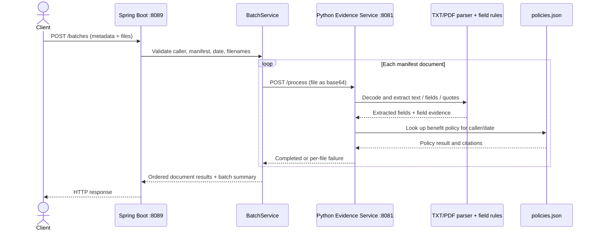
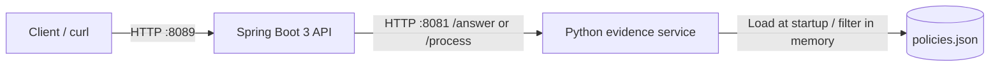
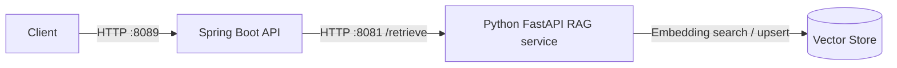

# Employee Support Assistant — Architecture

## Document summary

This is an evidence-first employee policy Q&A and reimbursement-triage demo. A caller asks a policy question or uploads reimbursement documents. Spring Boot provides the public API and resolves the caller's tenant and role; a local Python evidence service applies policy/date rules, extracts document fields, and returns source-backed results. Answers do not approve claims or trigger payments.

**Important accuracy note:** the checked-in application is not yet a vector-search RAG implementation. It uses a local `policies.json` corpus, rule-based topic matching and eligibility filters, and a deterministic offline answer generator. It does not currently use FastAPI, embeddings, chunking, a vector database, a prompt builder, or a hosted LLM. The target RAG diagram below is a possible evolution, not the running deployment.

## Technology choices

| Technology | Role in this project |
| --- | --- |
| Java 17 + Spring Boot 3.3.5 | Public HTTP API, request validation, caller lookup, batch orchestration, response contracts, and dependency error mapping. |
| Maven | Java dependency and build lifecycle; Spring Boot Maven plugin runs the API. |
| Python 3 | Policy/evidence rules, date and tenant/role filtering, deterministic answer output, and reimbursement document parsing. The current service uses Python's threaded standard-library HTTP server, **not FastAPI**. |
| pypdf | Extracts text from text-based PDFs during reimbursement processing; there is no OCR. |
| JSON (`python_service/data/policies.json`) | Small in-memory policy corpus loaded by the Python service at startup. This is **not a vector database**. |
| GitHub Codespaces | Development environment. The application listens on ports 8089 and 8081; set both forwarded ports to **Public** in the Codespaces Ports panel to allow external access. No Codespaces deployment configuration is checked in. |

## Components and responsibilities

| Component | Responsibility |
| --- | --- |
| `EmployeeSupportController` | Exposes `POST /answer` and `POST /batches`; reads `X-Caller-Id` and dispatches requests. It is the API entry point, not a separate API Gateway. |
| `CallerDirectory` + `RequestValidator` | Maps the exercise's synthetic caller ID to tenant/role and centralizes handwritten date and batch-manifest validation. Bean Validation annotations remain on request models. This header is a demo identity stand-in, not production authentication. |
| `PythonServiceClient` | Calls Python `/answer` or `/process`, validates downstream response shape, and maps timeouts/failures to API errors. Connect/read timeouts are 2s/8s; automatic retries are disabled. |
| Python `EvidenceService` | Applies exact tenant, role, approved-state, topic, and effective-date rules; returns insufficient evidence or conflicting citations when appropriate. |
| Policy corpus / citation mapper | Eligible policy records are held in memory from JSON. Each returned citation maps the source policy ID to `chunk_id` and includes its verbatim quote. `chunk_id` is a stable policy-record ID here, not a generated vector chunk. |
| Offline answer generator | Returns the exact eligible policy passage. Python validates that the generated string exactly matches evidence before returning `ANSWERED`. No hosted model or prompt builder is configured. |
| Python document parser | Strictly decodes UTF-8 TXT or extracts text from PDF, then identifies benefit, amount, currency, reference, field evidence, issues, and applicable policy. |
| `ApiExceptionHandler` | Converts invalid requests to HTTP 400, dependency timeouts to 504, and dependency failures to 502 with stable JSON error codes. Python provider failures become dependency errors; they are not reported as missing evidence. |

## Implemented question flow: `POST /answer`

1. **Client → API entry point:** send JSON containing `question` and `as_of`, plus `X-Caller-Id`. Spring runs on port **8089**.
2. **Validate and resolve caller:** Spring requires nonblank request fields, looks up the synthetic caller ID, and validates the date. Unknown/missing callers return `UNKNOWN_CALLER`; invalid dates return `INVALID_AS_OF`.
3. **Build trusted context:** Spring derives `tenant` and `role` from its caller directory; clients cannot choose these values in the answer request.
4. **Spring → Python:** `PythonServiceClient` POSTs `{tenant, role, as_of, question}` to Python `POST /answer` on port **8081**.
5. **Find eligible evidence:** Python classifies the question topic and filters the local policy records by exact tenant and role, `Approved` state, and `effective_from <= as_of < effective_to`. Instruction-like policy text is excluded. This is rule-based filtering, not embedding retrieval or context ranking.
6. **Determine the result:** no eligible evidence yields `INSUFFICIENT_EVIDENCE`; distinct eligible passages yield `CONFLICT`; one distinct passage is passed to the deterministic offline generator and checked against the evidence.
7. **Map citations and respond:** Python returns status, answer, and citations; each citation contains `chunk_id` (policy ID) and the verbatim `quote`. Spring verifies the response contract and returns it to the client.

The downstream route is `/answer` (not `/retrieve`); there is no separate answer-generation LLM call or retrieval-client ranking stage in this implementation.

### Request sequence

```mermaid
sequenceDiagram
    actor Client
    participant API as Spring Boot API :8089
    participant Directory as CallerDirectory / Validators
    participant ClientPy as PythonServiceClient
    participant Py as Python Evidence Service :8081
    participant Corpus as In-memory policies.json
    Client->>API: POST /answer + X-Caller-Id + JSON
    API->>Directory: Resolve caller; validate question and as_of
    Directory-->>API: tenant + role
    API->>ClientPy: answer(caller, as_of, question)
    ClientPy->>Py: POST /answer {tenant, role, as_of, question}
    Py->>Corpus: Topic + tenant/role/status/date filters
    Corpus-->>Py: Eligible policy evidence
    Py->>Py: Resolve ANSWERED / CONFLICT / INSUFFICIENT_EVIDENCE
    Py-->>ClientPy: status, answer, citations[{chunk_id, quote}]
    ClientPy-->>API: Validated AnswerResponse
    API-->>Client: HTTP 200 + response JSON
```

## Response example and curl test

Run both services locally as described in the [README](README.md), then:

```bash
curl -i http://localhost:8089/answer \
  -H 'Content-Type: application/json' \
  -H 'X-Caller-Id: atlas-employee-01' \
  --data '{"question":"What is my annual certification reimbursement limit?","as_of":"2026-09-21"}'
```

For the synthetic Atlas employee and date shown, the expected business response is HTTP 200:

```json
{
  "status": "ANSWERED",
  "answer": "The annual certification reimbursement limit for employees is INR 25000.",
  "citations": [
    {
      "chunk_id": "atlas-cert-current",
      "quote": "The annual certification reimbursement limit for employees is INR 25000."
    }
  ]
}
```

`curl -i` displays the HTTP status and headers as well as the JSON body. The `as_of` date selects the policy version effective on that date.

## Implemented batch ingestion: `POST /batches`

The public upload endpoint is **`/batches`** (plural), not `/batch`. It accepts a JSON `metadata` multipart part and repeated `files` parts. Spring checks that unique manifest filenames exactly match the uploaded files, validates the batch date, preserves manifest order, and sends each document to Python `POST /process` as base64 content.

Python decodes TXT or text-based PDF content, extracts reimbursement fields and supporting quotes, and looks up relevant policy evidence. Spring returns a per-document result and summary; an individual failed file does not stop the rest of the batch. Every item requires human review.

There is **no current chunk → embedding → vector upsert** stage in this batch path. The actual ingestion is:



## Infrastructure

### What runs today



In Codespaces, forward **8089** (public API) and **8081** (Python dependency) and set each port's visibility to **Public** in the Ports panel when external access is needed. For local development, the Java service defaults to `http://localhost:8081`; configure `PYTHON_SERVICE_URL` if the Python service is reached at a different host.

### Possible future RAG topology (not implemented)



A production RAG version could parse and chunk approved policy documents, generate embeddings during ingestion, upsert chunks and metadata into a vector store, retrieve/rank caller- and date-filtered context for questions, and use a grounded LLM with citation mapping. That would require adding these components and defining model, storage, filtering, and deployment choices; it should not be described as current behavior.

## Errors and operational boundaries

- Spring request/caller/date/manifest validation errors are HTTP 400.
- Python dependency timeout is mapped to HTTP 504 (`DEPENDENCY_TIMEOUT`); other downstream failures to HTTP 502 (`DEPENDENCY_FAILURE`).
- Python Q&A distinguishes `INSUFFICIENT_EVIDENCE` from provider failure. An evidence conflict returns `CONFLICT`, null answer, and the distinct supporting quotes.
- A batch can return HTTP success with individual `FAILED` document items; malformed batch metadata or file/manifest mismatch is a request-level HTTP 400.
- The demo has no production identity provider, persistent database, OCR, hosted LLM, payment action, or claim-approval action.
